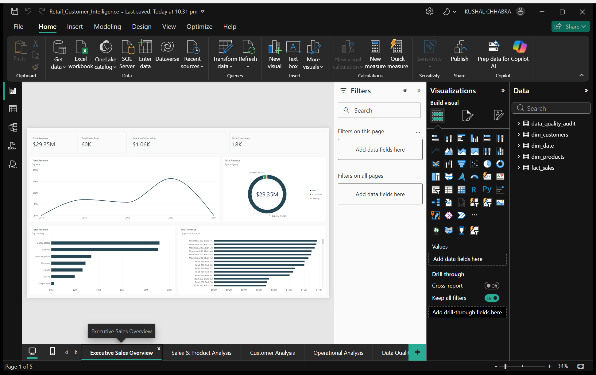
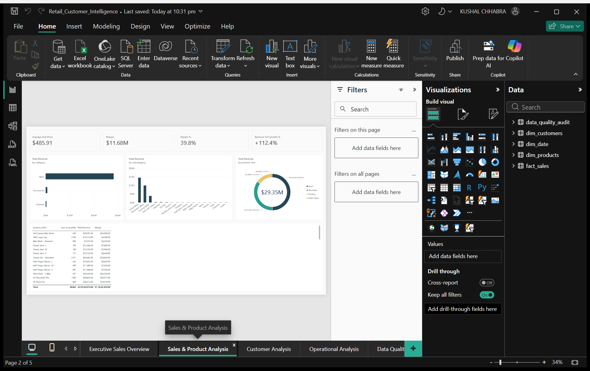
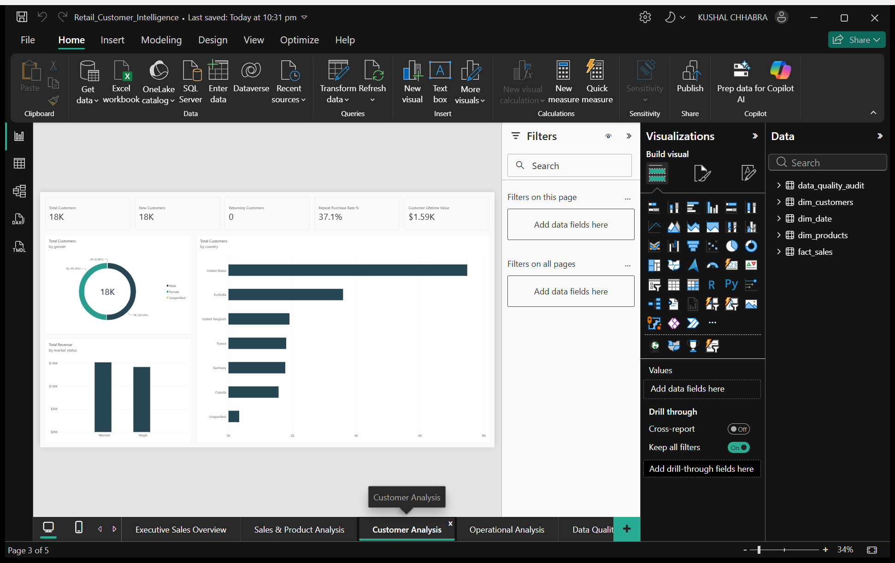
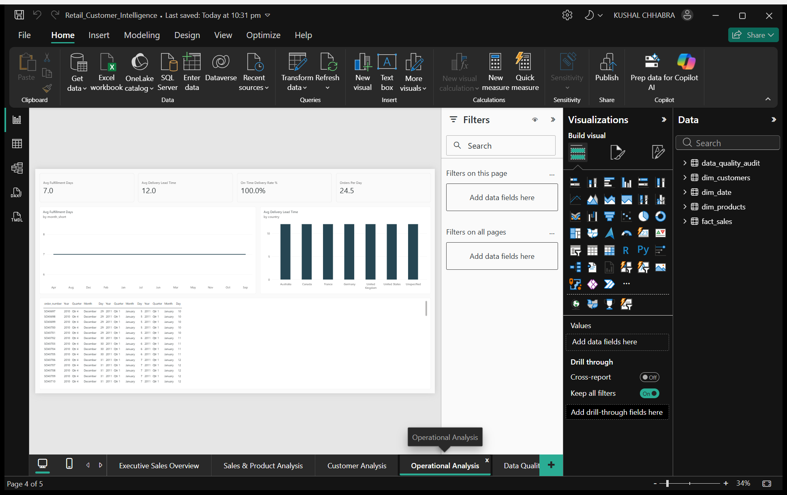
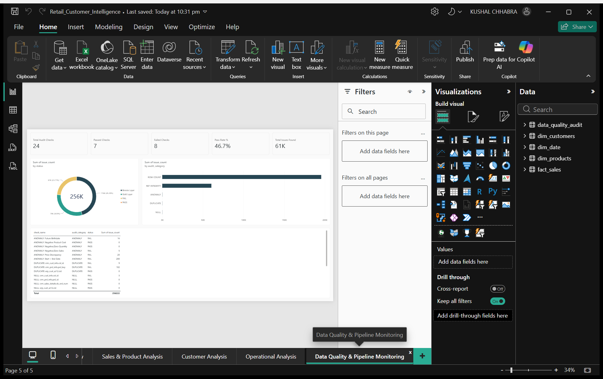

# Retail Sales & Customer Intelligence Platform

[](https://retail-customer-intelligence-rho.vercel.app/)
[](powerbi/Retail_Customer_Intelligence.pbix)
[](https://www.python.org/)
[](https://duckdb.org/)
[](https://react.dev/)
[](https://vitejs.dev/)
[](https://www.docker.com/)
[](LICENSE)

> 🌐 **Live Interactive Platform:** [retail-customer-intelligence-rho.vercel.app](https://retail-customer-intelligence-rho.vercel.app/)  
> 📊 **Power BI Report:** [`powerbi/Retail_Customer_Intelligence.pbix`](powerbi/Retail_Customer_Intelligence.pbix)  
> 📖 **Interview Deep Dive:** [`docs/project_deep_dive.md`](docs/project_deep_dive.md)

An enterprise-grade data engineering, machine learning, and business intelligence platform. This repository implements an end-to-end medallion data lakehouse pipeline—transforming raw CRM and ERP transactional data into a Gold star-schema warehouse, training unsupervised machine learning models for customer segmentation, forecasting 12-month Customer Lifetime Value (CLV), and delivering actionable insights via an interactive React web app and a 5-page Power BI executive suite.

---

## 🏛️ Medallion Architecture & Data Pipeline

```text
Raw Sources (CRM & ERP CSVs)
   │
   ▼
[BRONZE] Raw Ingestion & Staging (crm_*, erp_*)
   │
   ▼  (SQL Data Quality Audits, Cleaning & Deduplication)
[SILVER] Cleaned & Normalized Tables
   │
   ▼  (Dimensional Star-Schema Modeling)
[GOLD] Star Schema Warehouse (dim_customers, dim_products, fact_sales)
   ├──▶ Machine Learning: K-Means RFM (K=4) & BG/NBD + Gamma-Gamma CLV
   ├──▶ Analytical Engine (DuckDB): KPIs, Pareto 80/20 & Cohort Retention
   └──▶ Presentation Layer: Power BI Desktop Suite & Enterprise React 19 Dashboard
```

---

## ✨ Key Platform Features

* **Medallion Data Lakehouse:** Automated multi-stage SQL pipeline (`Bronze` $\rightarrow$ `Silver` $\rightarrow$ `Gold`) utilizing **DuckDB** for fast in-memory analytical processing.
* **Automated Data Quality Audits:** Pre-ingestion validation for primary keys, duplicates, date bounds, and referential integrity.
* **Dimensional Data Warehouse:** Star-schema architecture with central transaction table (`fact_sales`) joined with customer and product dimensions.
* **Machine Learning Customer Segmentation:** RFM feature extraction, K-Means clustering ($K=4$, Silhouette $0.602$, PCA evaluation), and behavioral playbooks (Champions, Loyal Core, At-Risk, Hibernating).
* **Probabilistic Predictive CLV:** **BG/NBD** transaction frequency modeling paired with **Gamma-Gamma** monetary value forecasting.
* **Cohort Retention Analysis:** Full monthly acquisition matrix ($M_0 \dots M_{12}$) calculating customer retention decay.
* **Enterprise UI/UX:** React 19 single-page application with 5 analytical views, Chart.js visualizations, and a bespoke design system.

---

## 🛠️ Technology Stack

| Domain | Technology | Purpose |
| :--- | :--- | :--- |
| **SQL Engine** | **DuckDB** | Columnar analytical processing engine & local data warehouse storage. |
| **Business Intelligence** | **Microsoft Power BI** | 5-page full-screen enterprise analytics dashboard with 32 DAX measures & star schema. |
| **Data Science & ML** | **Python 3.12 / Scikit-Learn** | Feature normalization, K-Means clustering, PCA, BG/NBD & Gamma-Gamma CLV. |
| **Data Analysis** | **Pandas / NumPy** | Matrix transformations, cohort aggregations, and data validation. |
| **Frontend UI** | **React 19 / Vite 8** | Modern single-page web application with modular React component architecture. |
| **Visualization** | **Chart.js / React-Chartjs-2** | Custom interactive line charts, bar charts, and doughnut distribution charts. |
| **DevOps & Container** | **Docker / Docker Compose** | Multi-stage Docker build served via Nginx web server. |
| **Hosting** | **Vercel** | Serverless global CDN deployment. |

---

## 📊 Power BI Enterprise Analytics Suite

### 1. Executive Sales Overview


### 2. Sales & Product Analysis


### 3. Customer Analysis


### 4. Operational Analysis


### 5. Data Quality & Pipeline Monitoring


---

## 📁 Repository Structure

```text
Retail-Customer-Intelligence/
├── data/              <- Raw CRM/ERP extracts & processed DuckDB warehouse
├── sql/               <- Medallion SQL pipeline (00_init through 08_cohort_retention)
├── python/            <- ML models (K-Means, BG/NBD CLV) & pipeline automation
├── dashboard/         <- Enterprise React 19 + Vite analytics web application
│   ├── src/           <- Modular React components, design system & charts
│   └── public/data/   <- Pre-computed analytical JSON datasets
├── powerbi/           <- 5-page Power BI report (.pbix), DAX guide & theme
├── docs/              <- Project deep dive, data dictionary & business findings
├── docker-compose.yml <- Containerized deployment configuration
└── requirements.txt   <- Python data science dependencies
```

---

## ⚡ Quick Start

```bash
# 1. Clone repository & install dependencies
git clone https://github.com/kushchhabra0/Retail-Customer-Intelligence.git
cd Retail-Customer-Intelligence
python -m venv .venv && source .venv/bin/activate  # or .venv\Scripts\activate on Windows
pip install -r requirements.txt

# 2. Build Medallion Data Warehouse & export analytical datasets
python python/build_dw.py
python python/export_data.py

# 3. Launch React Dashboard locally (http://localhost:5173)
cd dashboard && npm install && npm run dev
```

### Docker Deployment
```bash
docker-compose up --build  # Access at http://localhost:8080
```

---

## 📊 Key Business Findings & Executive Summary

* **Executive Revenue:** Total enterprise revenue reached **$29.35M** across **27,659 orders** with an AOV of **$1,061**.
* **Repeat Buyer Base:** **37.14%** repeat buyer rate (6,865 customers) provides a predictable baseline revenue stream.
* **Pareto (80/20) Concentration:** Top **15 product SKUs (1.8% of catalog)** generate **63.05% of total enterprise revenue**; top 35 SKUs generate 80%.
* **Regional Dominance:** The **United States ($9.16M)** and **Australia ($9.06M)** drive over 60% of total revenue. Australia has the highest AOV at **$1,348**.
* **Segment Strategy & CLV:**
  * **Champions (30% of accounts):** Expected 12M CLV of **$3,926**.
  * **At-Risk (13% of accounts):** Dormant >90 days; automated win-back workflows can recover substantial high-margin revenue.

---

## 📄 License & Author

This project is open-source under the [MIT License](LICENSE).  
Created as an enterprise analytical portfolio demonstration by **Kushal Chhabra**.
